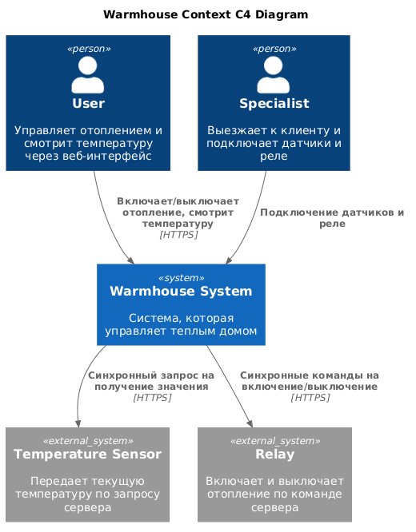

# Project_template

Это шаблон для решения проектной работы. Структура этого файла повторяет структуру заданий. Заполняйте его по мере работы над решением.

# Задание 1. Анализ и планирование

<aside>

Чтобы составить документ с описанием текущей архитектуры приложения, можно часть информации взять из описания компании и условия задания. Это нормально.

</aside>

### 1. Описание функциональности монолитного приложения

**Управление отоплением:**

- Пользователи могут удалённо включать/выключать отопление в своих домах.
- Пользователи не могут самостоятельно подключить датчик к системе
- Система поддерживает добавление новых датчиков специалистом на выезду
- Система поддерживает только синхронное управление, команда передаётся от сервера к модулю управления отоплением в доме.

**Мониторинг температуры:**

- Пользователи могут просматривать температуру конкретного датчика, а также по месту установки датчика `location` в своих домах через веб-интерфейс
- Система поддерживает только один тип датчиков `temperature`
- Система получает температуру синхронным запросом от сервера к датчику в момент обращения пользователя


### 2. Анализ архитектуры монолитного приложения

- **Язык программирования**: Go, фреймворк gin
- **База данных**: postgres, 1 таблица sensors, нет таблиц юзеров и домов, датчики фактически не привязаны к конкретному юзеру
- **Взаимодействие**: Синхронное, запросы обрабатываются последовательно, сервер опрашивает датчики с таймаутом 10 сек через HTTP
- **Архитектура**: Монолит, все компоненты системы находятся в рамках одного приложения. SensorHandler напрямую ходит и в БД и к датчикам.
- **Масштабируемость**: Ограничена, одна БД на все, опрос датчиков нельзя масштабировать отдельно от API, запрос GET /sensors опрашивает ВСЕ датчики по очереди, чем больше датчиков, тем дольше выполнение запроса.
- **Развертывание**: Через docker-compose, требует остановки и деплоя всего приложения.
- **Безопасность**: В приложении нет аутентификации и авторизации


### 3. Определение доменов и границы контекстов

- Домен "Управление устройствами"
	- поддомен "Реестр устройств"
		- контекст "Каталог поддерживаемых устройств"
		- контекст "Управление подключенными устройствами" (подключение/удаление/обновление)
	- поддомен "Отопление"
	- поддомен "Свет"
	- поддомен "Ворота"
	- поддомен "Видеонаблюдение"
	- поддомен "Пользовательские сценарии"
	- поддомен "Протоколы и адаптеры" (приём сообщений от устройств по разным протоколам, приведение к единому формату и доставка команд; здесь поддерживаются устройства партнёров.)
		*Помощь клода в формулировке поддомена для поддержки партнерских устройств*

- Домен "Мониторинг"
	- поддомен "Телеметрия"
		- контекст "Сбор показаний"
		- контекст "Журнал и история"

- Домен "Управление пользователями"
	- поддомен "Идентификация"
	- поддомен "Пользователи и дома" (профиль, дома и комнаты, участники дома и их роли)

### **4. Проблемы монолитного решения**

- Сложность масштабируемости, запрос GET /sensors опрашивает ВСЕ датчики по очереди, чем больше датчиков, тем дольше выполнение запроса.
- Система поддерживает только один тип датчиков temperature, добавление новых типов устройств потребует менять общую модель
- Все компоненты системы находятся в рамках одного приложения, необработанная ошибка в одной функции крашнет все приложение
- Деплой: для внедрения нового функционала придется пересобирать все приложение
- Кодовая база: Одновременная разработка нескольких фич разными разработчиками может привести к конфликтам

### 5. Визуализация контекста системы — диаграмма С4



[Исходник PlantUML](diagrams/context_c4_monolit.puml)

# Задание 2. Проектирование микросервисной архитектуры

В этом задании вам нужно предоставить только диаграммы в модели C4. Мы не просим вас отдельно описывать получившиеся микросервисы и то, как вы определили взаимодействия между компонентами To-Be системы. Если вы правильно подготовите диаграммы C4, они и так это покажут.

**Диаграмма контейнеров (Containers)**

Добавьте диаграмму.

**Диаграмма компонентов (Components)**

Добавьте диаграмму для каждого из выделенных микросервисов.

**Диаграмма кода (Code)**

Добавьте одну диаграмму или несколько.

# Задание 3. Разработка ER-диаграммы

Добавьте сюда ER-диаграмму. Она должна отражать ключевые сущности системы, их атрибуты и тип связей между ними.

# Задание 4. Создание и документирование API

### 1. Тип API

Укажите, какой тип API вы будете использовать для взаимодействия микросервисов. Объясните своё решение.

### 2. Документация API

Здесь приложите ссылки на документацию API для микросервисов, которые вы спроектировали в первой части проектной работы. Для документирования используйте Swagger/OpenAPI или AsyncAPI.

# Задание 5. Работа с docker и docker-compose

Перейдите в apps.

Там находится приложение-монолит для работы с датчиками температуры. В README.md описано как запустить решение.

Вам нужно:

1) сделать простое приложение temperature-api на любом удобном для вас языке программирования, которое при запросе /temperature?location= будет отдавать рандомное значение температуры.

Locations - название комнаты, sensorId - идентификатор названия комнаты

```
	// If no location is provided, use a default based on sensor ID
	if location == "" {
		switch sensorID {
		case "1":
			location = "Living Room"
		case "2":
			location = "Bedroom"
		case "3":
			location = "Kitchen"
		default:
			location = "Unknown"
		}
	}

	// If no sensor ID is provided, generate one based on location
	if sensorID == "" {
		switch location {
		case "Living Room":
			sensorID = "1"
		case "Bedroom":
			sensorID = "2"
		case "Kitchen":
			sensorID = "3"
		default:
			sensorID = "0"
		}
	}
```

2) Приложение следует упаковать в Docker и добавить в docker-compose. Порт по умолчанию должен быть 8081

3) Кроме того для smart_home приложения требуется база данных - добавьте в docker-compose файл настройки для запуска postgres с указанием скрипта инициализации ./smart_home/init.sql

Для проверки можно использовать Postman коллекцию smarthome-api.postman_collection.json и вызвать:

- Create Sensor
- Get All Sensors

Должно при каждом вызове отображаться разное значение температуры

Ревьюер будет проверять точно так же.


